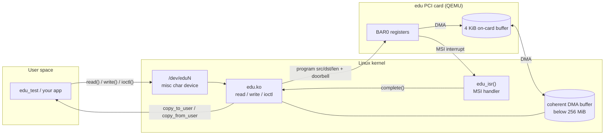
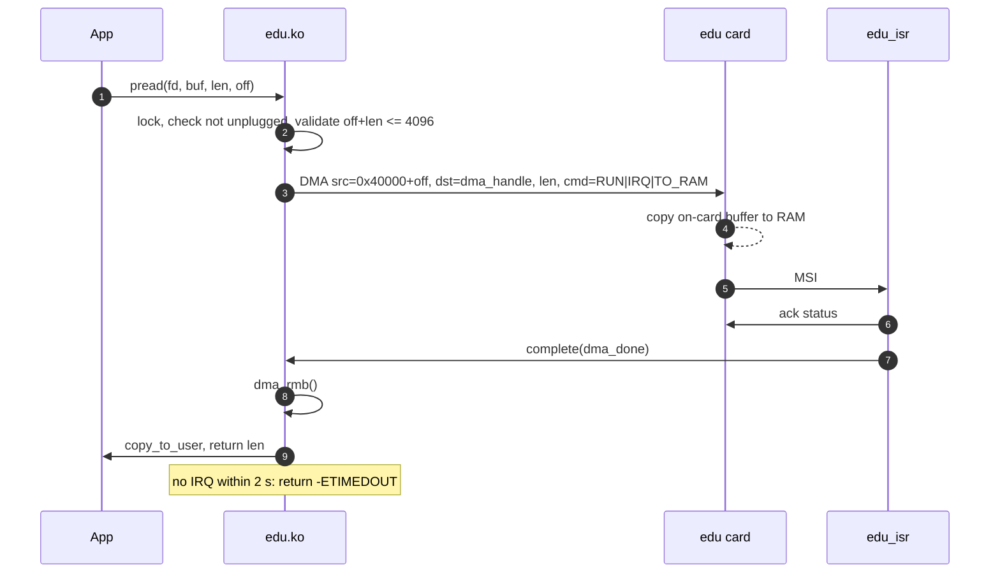
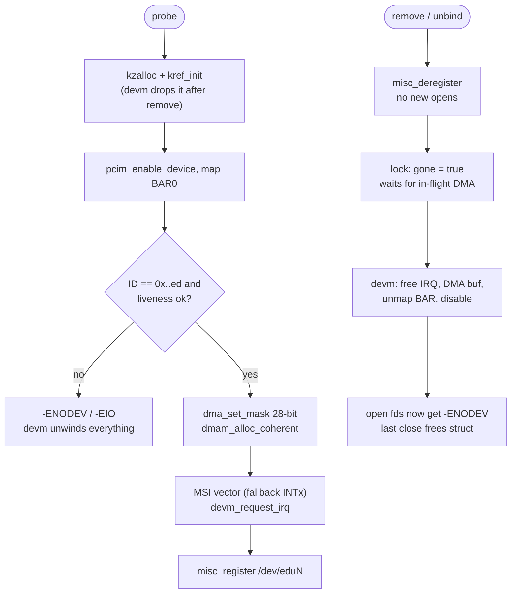

# edu-pci-driver

A Linux kernel PCI driver for QEMU's `edu` device (PCI `1234:11e8`), a virtual card built for teaching driver development. It exercises the parts every real PCI driver has to get right:

| Area | What the driver does |
|---|---|
| **Probe / remove** | `pcim_*` / `devm_*` managed resources, so every error path and unbind releases exactly what was acquired, in reverse order |
| **MMIO** | Maps BAR0, verifies the ID register and a liveness handshake before trusting the card |
| **Interrupts** | Requests **MSI**, falls back to **shared legacy INTx**; the ISR returns `IRQ_NONE` for a shared line that isn't ours and acks before completing waiters |
| **DMA** | Declares the card's real **28-bit DMA mask**, uses a coherent buffer, and orders CPU and device accesses (`iowrite32` doorbell, `dma_rmb()` after the IRQ) |
| **Safety** | Validates every DMA range in the driver: the card has no protection and an out-of-range request aborts the whole machine |
| **Char device** | `/dev/eduN` via `misc`: `read`/`write` = DMA to/from the 4 KiB on-card buffer, `lseek`, and ioctls for info, liveness and a hardware factorial signalled by IRQ |
| **Timeouts** | Completion waits with a 2 s timeout, so a dead card returns `-ETIMEDOUT` instead of hanging the process |
| **Hot-unplug** | The device struct is **reference counted**; a process still holding `/dev/eduN` after unbind gets `-ENODEV`, never touches freed memory or unmapped registers |

## Architecture



### A `read()` end to end



### Probe and safe unplug



## Layout

```
driver/edu.c                 the kernel module
include/uapi/edu_ioctl.h     userspace ABI (ioctls, struct edu_info)
tests/edu_test.c             end-to-end suite; also runs as PID 1 in QEMU
scripts/run-qemu.sh          boots kernel + initramfs with -device edu
kernel.config                Linux 6.6 config: PCI/MSI + KASAN + lockdep + DMA-API debug
.github/workflows/ci.yml     builds the kernel, the module, boots QEMU, runs the suite
```

## Run it

On a Linux machine with QEMU:

```sh
git clone --depth 1 --branch v6.6 https://github.com/torvalds/linux ~/linux
cp kernel.config ~/linux/.config && make -C ~/linux olddefconfig
make -C ~/linux -j"$(nproc)" bzImage modules
make qemu KDIR=~/linux
```

`make qemu` builds `edu.ko` with `W=1 -Werror`, packs it with the test binary into an initramfs, boots QEMU with `-device edu`, and the test (running as `/init`):

1. loads the module and finds `/dev/eduN`
2. checks ID, MSI mode, liveness and unknown-ioctl handling
3. computes factorial 0..12 on the card, one interrupt each
4. DMAs a full 4 KiB pattern out and back
5. tests odd offsets, clipping at the end of the buffer, EOF, `ENOSPC`, bad `lseek`, bad user pointer (`EFAULT`)
6. runs 4 processes doing DMA on disjoint windows at the same time
7. **unbinds the driver while a file is open**, expects `ENODEV` on that fd, rebinds and uses the card again
8. unloads the module and scans the kernel log for KASAN, lockdep, `WARNING`, DMA-API or Oops reports

and prints `RESULT: PASS` or `FAIL`.

## Verification status

[](https://github.com/ribhu0908/edu-pci-driver/actions/workflows/ci.yml)

Every push builds Linux 6.6 with KASAN, lockdep and DMA-API debugging, builds `edu.ko` with `W=1 -Werror`, boots it in QEMU with `-device edu`, and runs the suite. A passing run looks like this:

```
edu 0000:00:04.0: edu v1.0 at /dev/edu0, MSI irq 24, dma buf 0x00000000057dc000
[ RUN  ] test_info_and_liveness
  device /dev/edu0 v1.0, irq=MSI
[ RUN  ] test_factorial_via_irq
[ RUN  ] test_dma_roundtrip_full_buffer
[ RUN  ] test_dma_offsets_and_bounds
[ RUN  ] test_concurrent_processes
  irqs=67 dma=54 bytes=57564 spurious=0
[ RUN  ] test_hot_unplug_with_open_file
edu 0000:00:04.0: removed /dev/edu0 (irqs=67 dma=54 timeouts=0)
[ LOG  ] kernel log scan: clean (no KASAN/lockdep/WARN/DMA-API reports)

66 checks, 0 failed
RESULT: PASS
```

The first CI runs caught two real issues, both fixed: the kernel build step did not produce `Module.symvers`, so `modpost` could not link the module; and the log scanner matched the kernel's informational `DMA-API: debugging enabled` boot line. It now matches only reports that name this driver.

## Design notes

- **Ack before complete in the ISR.** The device latches status until acked (for MSI as well), and acking first means an event raised while the handler runs is not lost.
- **Why not `devm_kzalloc` for the device struct?** `devm` memory is freed when the device unbinds, but an open file can outlive that. The struct is `kref`-counted: the probe holds one reference (dropped by `devm` after `remove()`), each open file holds one.
- **28-bit DMA needs `CONFIG_ZONE_DMA`.** With a DMA mask below 32 bits the kernel must be able to allocate from the low DMA zone; without it `dma_set_mask_and_coherent()` or the coherent allocation can fail at probe. `kernel.config` enables it.
- **No new opens after unbind.** `misc_open()` and `misc_deregister()` take the same mutex, so `kref_get()` in `open` can't race with removal.
- **Remove waits for in-flight work.** `remove()` takes the device mutex before setting `gone`, so a DMA already in progress finishes before the IRQ and MMIO are torn down.

## License

GPL-2.0 (kernel module); the UAPI header is `GPL-2.0 WITH Linux-syscall-note`.
